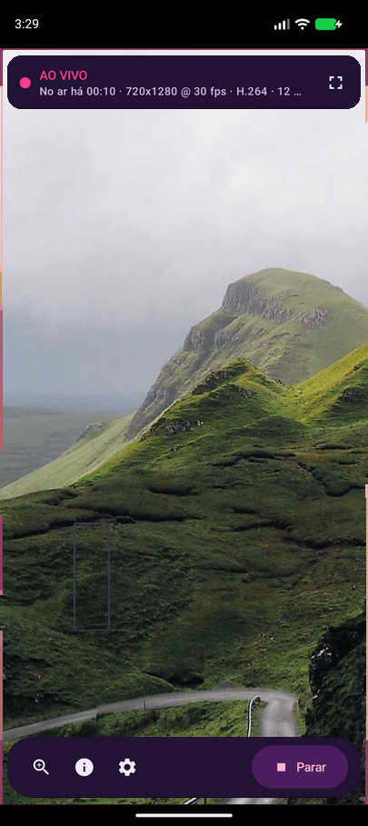
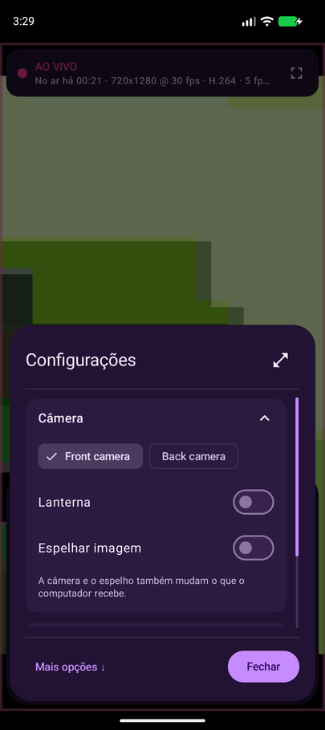
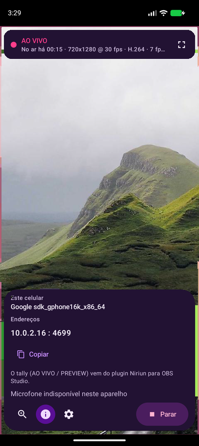
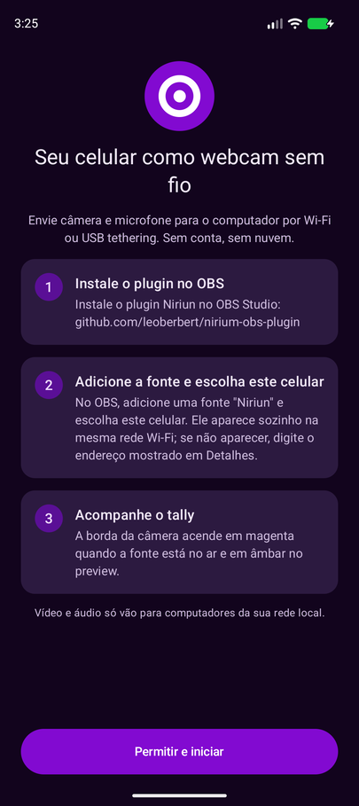
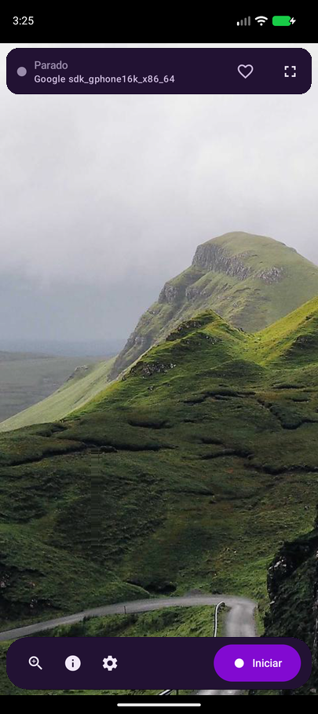
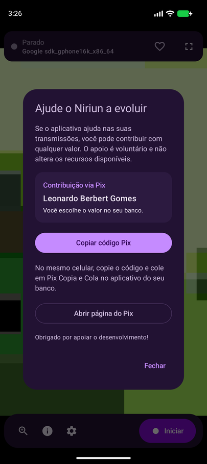

<h1 align="center">📱 Niriun</h1>

<p align="center">
  <strong>Seu celular Android como câmera sem fio para o OBS Studio, com tally de verdade.</strong><br>
  Envia câmera e microfone pela rede Wi-Fi ou por cabo USB, sem conta e sem nuvem, e acende a borda da tela quando a fonte está no ar.
</p>

<p align="center">
  <a href="https://github.com/leoberbert/Niriun/releases/latest"></a>
  <a href="https://github.com/leoberbert/Niriun/actions/workflows/ci.yml"></a>
  <a href="LICENSE"></a>
</p>

<p align="center">
  
  
  
  
  
</p>

<p align="center">
  <a href="#-plugin-necessário-para-o-obs">🧩 Plugin</a> •
  <a href="#-primeiros-passos">🚀 Primeiros passos</a> •
  <a href="#-telas">📸 Telas</a> •
  <a href="#-como-o-tally-funciona">🔴 Tally</a> •
  <a href="#-compilar-e-testar">🔨 Compilar</a> •
  <a href="#-documentação">📚 Docs</a>
</p>

<p align="center">
  
  
  
</p>

---

## 🎯 Em resumo

| | |
|---|---|
| 📷 **Câmera sem fio** | H.264 ou HEVC até 4K/60, com áudio Opus do microfone |
| 🔴 **Tally** | Borda **magenta** quando a fonte está no ar no OBS e **âmbar** no preview |
| 🛡️ **Segurança ao vivo** | Dupla confirmação antes de parar, e confirmação antes de trocar a câmera ou o espelho, enquanto está no ar |
| 🔌 **Wi-Fi ou USB** | Descoberta automática na rede, ou `adb` por cabo |
| 🎛️ **Controles** | Zoom por pinça, lanterna, espelho, troca de câmera, foco por toque |
| 🧩 **Plugin para o OBS** | Um instalador no computador, sem driver de câmera virtual |
| 🆓 **Livre** | Apache-2.0, sem anúncios e sem coleta de dados |

---

## 🧩 Plugin necessário para o OBS

O Niriun **só envia** a imagem. Para usá-la no OBS Studio é preciso instalar o
[**plugin Niriun para OBS**](https://github.com/leoberbert/nirium-obs-plugin) no computador (Windows ou Linux, OBS 32 ou superior). Ele recebe o
vídeo e o áudio, cria a fonte "Niriun" no OBS e devolve o **tally** ao celular. Não é preciso mais nada no computador: nem o
cliente do Iriun Webcam, nem driver de câmera virtual, nem o OBS WebSocket.

1. 📥 Baixe o pacote do seu sistema (Windows: instalador `niriun-obs-<versão>-windows-x64-setup.exe` ou `.zip` portátil; Linux: pacote da versão correspondente) na
   [página de releases do plugin](https://github.com/leoberbert/nirium-obs-plugin/releases/latest) e instale com o OBS fechado.
2. 📱 No celular, abra o Niriun e toque em **Iniciar**.
3. 🎬 No OBS: **Fontes → + → Niriun**, escolha o celular em **Dispositivo** e clique em **Ativar**.

Sem o plugin o celular transmite, mas nada recebe o vídeo no OBS e o tally fica desligado (o cliente oficial do Iriun ainda
recebe o vídeo, sem tally). O passo a passo completo, as opções da fonte e a solução de problemas estão no README do plugin.

---

## 🚀 Primeiros passos

1. 📲 Instale o app no celular (APK da [página de releases](https://github.com/leoberbert/Niriun/releases/latest)) e abra.
2. ✅ Na primeira vez o app explica o que faz e pede as permissões: **câmera** (obrigatória), **microfone** e **notificações**
   (opcionais) e, no Android 17+, **rede local**, para o computador encontrar o celular.
3. ▶️ Toque em **Iniciar**. O celular passa a aparecer para o computador (status "Aguardando o computador").
4. 🎬 Adicione a fonte Niriun no OBS e clique em **Ativar**. O status vira "Enviando vídeo".
5. 🔴 Coloque a fonte em uma cena: a borda do celular acompanha o que acontece no OBS.

Se o celular não aparecer no OBS, abra **Detalhes** no app (toque no status, no topo) e digite o endereço mostrado em
**Usar IP do WiFi**, no plugin.

---

## 📸 Telas

<table align="center">
  <tr>
    <td align="center"><br><sub><b>Boas-vindas</b><br>3 passos e permissões</sub></td>
    <td align="center"><br><sub><b>Pronto para iniciar</b><br>prévia e barra de ferramentas</sub></td>
    <td align="center"><br><sub><b>AO VIVO</b><br>borda de tally e relógio</sub></td>
  </tr>
  <tr>
    <td align="center"><br><sub><b>Detalhes</b><br>endereço para conectar</sub></td>
    <td align="center"><br><sub><b>Configurações</b><br>câmera, tally e sobre</sub></td>
    <td align="center"><br><sub><b>Apoie o projeto</b><br>contribuição via Pix</sub></td>
  </tr>
</table>

> As telas foram capturadas em um emulador Android (a "câmera" é uma cena virtual) com o plugin simulado.

### 🖐️ Como usar a tela

| Gesto | O que faz |
|---|---|
| Tocar na imagem | Mostra os controles (eles somem sozinhos 5 s depois, durante a transmissão) |
| Pinça | Zoom (multiplicativo, de 1× a 10×) |
| Tocar no status (topo) | Abre os **Detalhes**: nome do celular e endereço para conectar |
| ⛶ no topo | Recolhe os controles e deixa só a imagem |
| ❤️ no topo | Apoiar o projeto (só aparece quando não está transmitindo) |
| 🔍 ℹ️ ⚙️ embaixo | Zoom, Detalhes e Configurações |
| ❓ nas Configurações | Ajuda: o que fazer no OBS (instalar o plugin, adicionar a fonte, tally) |

### ⚙️ Configurações

Tudo vale na hora e fica salvo, sem botão Salvar. As seções seguem o DroidNDI:

| Seção | Opções |
|---|---|
| 📷 Câmera | Câmera, lanterna, espelhar |
| 🎨 Imagem | Brilho, contraste e saturação (valem para a prévia e para o que o OBS recebe) e grade de enquadramento (terços ou cruz, só nesta tela) |
| 🎙️ Microfone | Enviar ou não o áudio ao OBS |
| 🖥️ Tela e controles | **Economia de tela** (normal, escurecer ou quase apagada enquanto os controles estão escondidos), controles (automático, compacto ou sempre) e **Ao parar, o OBS mostra** (preto ou cartão offline) |
| 🔴 Tally | Aviso na tela e vibração: desligado, só no ar, ou no ar e preview |

Resolução, fps e nome da fonte não existem aqui: quem decide é o plugin no OBS. A opção "Ao parar, o OBS mostra" usa a mensagem `0x31` (ver [PROTOCOL.md](docs/PROTOCOL.md)) e precisa do plugin com essa versão.

---

## 🔴 Como o tally funciona

O OBS sabe em que estado cada fonte está, e o plugin avisa o celular pela mesma conexão do vídeo (mensagem `0x30`):

| No OBS | No celular |
|---|---|
| Fonte **no programa** (saída) | 🟣 Borda magenta, `AO VIVO` e há quanto tempo está no ar; vibra quando entra |
| Fonte **só no preview** (Modo Estúdio) | 🟠 Borda âmbar e `PREVIEW` |
| Fonte fora de uso | Sem borda |

Com a fonte no ar, parar a transmissão pede **dupla confirmação**, e trocar de câmera ou espelhar pede uma confirmação. Sem o plugin conectado o
app não sabe o estado e mostra tudo desligado.

---

## ⚙️ O que faz por dentro

| Área | Implementação |
|---|---|
| 🔎 Descoberta | NSD `_iriunwebcam._tcp.` (4699), beacon UDP multicast de 280 B a cada 2 s (`239.255.188.58:4698` e `ff02::2:d644`), sonda TCP 4697 |
| 🔗 Transporte | `ControlServer`: TCP `[::]:4699`, 1 cliente, `TCP_NODELAY`, timeout ocioso de 10 s, watchdog de escrita de 4 s |
| 🎥 Vídeo | Camera2 → `GlRenderer` (OES → rotação/espelho/letterbox) → `MediaCodec` H.264/HEVC → pacote `0x08` |
| 🎙️ Áudio | `AudioRecord` 48 kHz mono → encoder Opus da plataforma (20 ms) → pacote `0x07` |
| ⏱️ Fluxo | ACK `0x09` por quadro + limite de quadros em voo no encoder (`FlowControl`, `EncoderBacklog`) |
| 🎛️ Controles | zoom, lanterna, espelho, EV, balanço de branco, ISO/tempo de exposição, travar AE/AWB, foco manual, toque para focar, trocar câmera |
| 🔴 Tally | Mensagem `0x30` enviada pelo plugin (§4.5 do protocolo; sem WebSocket) |
| 🔒 Senha | Não implementada: o desafio `0x17` do Iriun (§4.4 do protocolo) foi removido do app |
| 🖼️ UI | Compose, no mesmo layout do DroidNDI em roxo: prévia em tela cheia, barra superior, painel inferior e Configurações em painel |

Pacotes: `protocol/` (puro Kotlin, testável na JVM), `net/` (sockets e descoberta), `stream/` (câmera, GL, codecs,
sessão, serviço em primeiro plano), `ui/`.

O protocolo, com o endereço de cada evidência na `libnative-lib.so`, está em [`docs/PROTOCOL.md`](docs/PROTOCOL.md). Nenhum
código ou asset do Iriun foi copiado: tudo aqui foi escrito do zero a partir do comportamento observado.

### 🧪 Diferenças deliberadas em relação ao Iriun

- Intervalo de IDR de **2 s** (o Iriun usa 15 s): recupera mais rápido de qualquer falha.
- `SYNC` (`0x04`) só zera o relógio com o stream parado; no meio do stream faria os timestamps voltarem e o
  `GraphicBufferSource` do Android descartaria todos os quadros.
- O renderizador também pula quadros quando o encoder acumula mais de 3 quadros (latência limitada em encoders lentos).
- Sem as travas "pro" do Iriun (4K/60 fps e controles manuais liberados para todos).
- Não envia as mensagens de info `0x13–0x16`/`0x19` (campos não confirmados; o Iriun gratuito também não envia).

---

## 🔨 Compilar e testar

```bash
./gradlew testDebugUnitTest     # testes JVM: protocolo, framing, servidor TCP em loopback, beacon multicast
./gradlew assembleDebug         # app/build/outputs/apk/debug/app-debug.apk
```

Requisitos: JDK 17+ e Android SDK com a plataforma 37 (AGP 9.3.2, Gradle 9.5.0, Compose BOM 2026.09.00).

### 🧰 Testar sem o plugin

`tools/pc-sim/pc-sim.js` (Node) imita o cliente do PC: lê hello/tamanhos/câmeras, envia `START`, confirma cada quadro e grava o
fluxo elementar para decodificar com ffmpeg.

```bash
adb forward tcp:4699 tcp:4699
node tools/pc-sim/pc-sim.js --seconds 10 --size 1280x720 --fps 30 --audio --out out.h264 --verbose
node tools/pc-sim/pc-sim.js --codec hevc --out out.h265
node tools/pc-sim/pc-sim.js --control zoom=50,torch,next-camera
node tools/pc-sim/pc-sim.js --tally program --tally-name "Camera 1"   # envia o tally 0x30 após o START (off|preview|program)
ffprobe -count_frames -select_streams v:0 out.h264
```

---

## 🚧 Limitações conhecidas

- O vídeo chega ao OBS pelo plugin Niriun, que fala o mesmo protocolo TCP 4699 como cliente do PC. O cliente oficial do
  Iriun Webcam ainda funciona para o vídeo, mas sem tally.
- Testado com OBS 32 e 33 e um Samsung SM-S938B (Android 17); outros aparelhos e fabricantes ainda não foram testados.
- O HEVC depende do encoder do celular: alguns (e o emulador) recusam o perfil usado.
- O tally só existe enquanto um plugin (ou o `pc-sim --tally`) estiver conectado.

---

## 📦 Releases

O CI (`.github/workflows`) roda testes, lint e APK debug a cada push. A release assinada (APK + AAB) é manual, por
Actions → Release. Detalhes em [`docs/ci-cd.md`](docs/ci-cd.md) e [`docs/PLAY-STORE.md`](docs/PLAY-STORE.md).

---

## 📚 Documentação

| Documento | Conteúdo |
|---|---|
| [`docs/PROTOCOL.md`](docs/PROTOCOL.md) | Protocolo observado no Iriun, mais a extensão de tally (`0x30`) |
| [`docs/ANALYSIS.md`](docs/ANALYSIS.md) | Como a análise do app original foi feita |
| [`docs/WINDOWS.md`](docs/WINDOWS.md) | Análise do cliente Windows do Iriun (histórico) |
| [`docs/BENCHMARK.md`](docs/BENCHMARK.md) | Roteiro para medir o atraso contra o DroidNDI |
| [`docs/ci-cd.md`](docs/ci-cd.md) | Workflows, segredos e como publicar uma versão |
| [`docs/PLAY-STORE.md`](docs/PLAY-STORE.md) | Checklist da Play Store |
| [Plugin para o OBS](https://github.com/leoberbert/nirium-obs-plugin) | Instalador, opções da fonte e solução de problemas |

---

## 🙏 Aviso e licença

Projeto independente, sem vínculo com o Iriun. "Iriun" é marca de seus donos. O protocolo foi documentado por observação do
comportamento do app para fins de interoperabilidade. Licença **Apache-2.0** (veja [LICENSE](LICENSE)). O plugin para o OBS é
outro programa (GPL-2.0-or-later) que conversa com o app pela rede.
